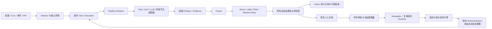

# IQC 智能质检平台 PRD V1.0：现有系统实施与改造分析

日期：2026-10-04。性质：设计建议，不代表下述能力已经实现或上线。

需求来源：[IQC智能质检平台_PRD_V1.0.md](../../IQC智能质检平台_PRD_V1.0.md)。完整阅读需求后，对照 IQC V2 方案、当前源码、数据库迁移，以及 OpenSabre Wiki 和对应原始文档进行静态分析。本地包含此前 V2 修改和其他未提交配置，功能判断以具体实现为依据；上线基线参考本次 V2 发布的后端 `bac0a1236de7472956876fa9e35012bcf7d87692`。本文没有重新验证线上、真实模型效果或吞吐量。

## 1. 总体判断

PRD 的 V1.0 是文档版本，不能理解为现有 IQC V2 的旧版本。它定义的是更宽的平台目标：从业务方案驱动质检，扩展为 Trigger → Selector → Pipeline → Finding/Fusion → Decision → Action → Review → Evaluation 的闭环。

建议在现有 IQC 内增量建设，保留业务方案作为用户入口，把 Pipeline 和策略作为方案引用的版本化能力。初期保持一个后端应用，通过模块边界和独立工作池解耦；吞吐与隔离需求被验证后再决定部署独立 worker。无需先新增通用工作流平台、模型网关微服务或另一套质检产品。

首期重点：统一事实协议、可追踪的流水线执行、复核到评测集的闭环。现有 V2 的四种项目路线可作为兼容适配器，不能直接宣称已经具备 PRD 的通用 Pipeline。

## 2. 需求与现状差距

| PRD 能力 | 当前可复用基础 | 需要实施的改造 |
| --- | --- | --- |
| Scene / QualityPlan | 业务方案、模板、方案版本、场景字段 | QualityPlan 映射现有方案；扩展其版本内容，不另建同义方案主表 |
| 版本与发布 | 依赖冻结、摘要、历史版本、草稿真实试跑和确认发布 | 扩展 Pipeline/Fusion/Decision 版本引用；增加评测门禁、审批与灰度记录 |
| 批量、定时、API 任务 | 任务、执行轮次、任务明细、一次性定时筛选 | 区分周期定义和每次实例，增加 Cron、事件接入、发生次序与幂等键 |
| Selector | 时间、归属、渠道、员工、客户、业务号等筛选和定量抽样 | 条件树、比例/分层抽样、预览统计、游标选取；避免全候选载入内存 |
| Pipeline | 四种逐项目规则/LLM 路线、适用条件、输入范围、上下文去重 | 节点协议、输入输出映射、变量、节点记录、条件、超时、重试和降级 |
| 多引擎 | RuleMatcher、DLS、LLM provider、Agent 资产、MCP 工具 | 以适配器接入；新增 Metric/SmallModel/Session/外部 Skill API 时遵守同一契约 |
| Finding / Evidence | 规则结果、findingJson、文本证据、业务项目结果 | 统一语义编码和类型；保存多节点原始事实及来源；扩展音频/业务字段证据 |
| Fusion | 同一路线多轮裁决、标签确定/未知/冲突语义 | 独立跨引擎融合政策，保留原始事实、冲突原因、证据和来源映射 |
| Score / Label | 独立评分、否决、待确认分数、标签版本及联合检测 | 增加维度/权重/等级、事实到标签映射；只改政策时支持生成重算修订 |
| Risk | 规则风险及结果风险字段 | 独立版本化风险政策，支持事实、标签、分数和业务字段组合 |
| Action | 已有结果保存、标签结果、复核申请；平台通知能力 | 持久化动作记录、幂等、失败重试、Webhook；工单/辅导先核验目标系统接口 |
| Review | 业务项和标签复核队列、复核修订、机器结果保留 | 事实/证据修订、反馈类型、二审仲裁、评测候选审批 |
| Evaluation | 质量样本及预期结果 JSON、效果统计 | 全会话金标快照、数据集版本、评测任务、逐样本差异、指标和发布阈值 |
| 会话标准化 | 文件/API 导入、会话/消息、业务归属、文本时间标记 | ASR 状态、音频引用、毫秒片段、说话人置信度、业务上下文和输入修订 |
| 模型管理 | 模型配置、主备模型路由、Agent/Skill 快照与版本 | 部署修订标识、真实调用用量、成本、全局并发预算、结构化失败分类 |
| 可观测与权限 | 用量计数、组织 RBAC、数据范围、网关授权、审计基础 | 节点级 trace/延迟、积压、动作失败、模型成本；敏感字段独立授权 |

这些能力不能按页面数量估算完成度。现有“样本管理”不等于可发布的数据集，“多轮裁决”不等于多引擎融合，“Skill 指令资产”不等于独立 Skill API 节点，“试跑通过”不等于质量指标门禁。

## 3. 推荐结构与职责

建议在 `iqc-platform` 内新增 `pipeline`、`finding`、`fusion`、`evaluation`、`action` 模块；扩展现有 `scheme`、`task`、`result`、`scoring`、`label`、`quality`、`conversation`、`modelprofile`。模块名是职责建议，不要求每个都成为服务或独立表。

检测节点只输出事实和证据；融合只解决事实选择与冲突；决策生成分数、标签、风险及复核要求；Action 执行外部副作用。外部 Skill/MCP 调用必须声明是否有副作用，评测运行默认不允许真实告警、工单或业务写入。

### 3.1 Pipeline：先有限编排，再扩展 DAG

先定义有版本的 `NodeDefinition`、`NodeContext`、`NodeResult` 和 `NodeExecution`。节点必须记录输入摘要、实际资产版本、状态、尝试次数、开始结束时间、耗时、输出事实和错误类型。

初版支持列表顺序、条件分支、规则初筛后调用 LLM、显式降级；保留现有四种路线的行为。并行节点在同一协议稳定后引入，必须定义依赖、变量写入冲突、取消和超时语义。拖拽 DAG 放到后续，不用画布成熟度替代执行正确性。

重复检测缓存只能在输入内容/输入范围、规则与模型配置、Prompt/Skill/知识版本、执行上下文完全相同的情况下复用。不得仅以 ruleId 或 Finding code 去重。评测多轮、模型随机性实验应明确禁用跨轮缓存。

技术失败、未运行、未知、冲突和确定未发现必须分开。最终高风险事实引用有效证据；不可把解析失败解释为安全，也不可让缺失节点默默成为零扣分的合格结果。

### 3.2 Finding：改造的核心边界

定义统一输出：语义 code、typed value、状态、置信度、严重度、原因、Evidence 引用、node/engine/资产版本和轮次。跨引擎识别同一业务事实时使用同一语义 code；规则编码仍表示检测配置，两者不强行等同。

现有 `iqc_inspection_rule_result` 对会话结果与规则存在唯一约束，适合规则结果投影，无法自然保存同规则多节点、多轮的所有独立事实。优先通过协议适配保留该投影；在确认查询与审计需求后新增规范化原始 Finding 存储，并让既有结果引用它。新增的理由是保存检测发生记录和多来源事实，不是复制现有规则结果。

Evidence 复用现有证据概念和内容结构。扩展为原始 Finding 可引用的证据关系，以及音频范围、业务字段、知识材料等类型，避免新旧两套证据内容永久重复写入。旧文本字符偏移保持原义。

### 3.3 Fusion 与 Decision

第一版优先实现明确优先级、显式覆盖和冲突转复核。不同引擎的 confidence 未校准前，不建议直接比较数值大小，更不应默认加权平均。Voting 的投票单元、重复来源和缺席必须定义。

融合结果应说明选用了哪些事实、舍弃了哪些事实及原因，版本绑定 FusionPolicy。既有多轮投票和标签解析可以提供适配逻辑，但不能直接作为通用融合服务。

继续复用 `InspectionScoring`。评分、标签、风险和复核政策都读取已融合事实及冻结业务上下文。仅评分政策变化时生成新的决策修订，不重新调用模型、不覆盖历史机器输出。若变化涉及新事实输入、检测范围或模型，则生成新的检测执行。

展示需区分机器结果、人工复核结果和政策重算结果，并注明报表使用哪种口径。重算是否重新触发告警须显式配置，默认不重放外部副作用。

## 4. 任务、可靠执行与实时处理

当前有任务状态、原子抢占、数据库执行记录、消息明细、暂停/取消和超时恢复。调度器按固定间隔物化到期的一次性任务，执行采用 `@Async` 和每任务线程池。超时恢复把过期 QUEUED/RUNNING 标记为失败，可供重试；这不是完整的自动可靠队列。

第一阶段可以扩展现有数据库队列：共享 worker 池、领取租约、独立心跳、恢复扫描、分片游标和全局模型预算。随后根据实测引入 MQ 通知 worker；数据库仍保存执行状态和幂等约束。避免每个大任务独占一套线程池。

周期任务增加定义与实例的关系，每次调度冻结动态时间窗口、选择条件和实际会话清单。建议幂等键包含触发来源/事件 ID 或周期 occurrence、方案版本、会话与输入修订；显式重跑产生新执行轮次。单纯“任务实例 + 会话 + 方案版本”不足以表达补录 ASR 或修正输入。

实时事件沿用现有平台认证和事件接口。分别处理 ConversationCompleted 与 ASRCompleted 的顺序、补发及重复，明确何种输入状态可以执行。独立资源预算保护实时延迟，批处理不得占满模型额度。PRD 的实时需要明确为“完成后近实时”还是“通话进行中检测”；后者还需增量会话、滑动窗口和 provisional Finding，不属于现有整会话流程的小改动。

EDA starter 提供发布/处理接口和 transport 扩展点，不内置持久化 MQ 或事务 Outbox。`publishAfterCommit` 存在提交后发送前的丢失窗口。关键 Action 使用应用内持久化动作/Outbox 与确认、重试；复用 EventTransport API，不能把本地异步事件当可靠任务队列。

百万级批处理和 P95 示例是待验证目标。先定义会话长度、模型部署、并发、重试、样本分布及统计窗口，容量结果才可比较。

## 5. 复核、金标与评测闭环

复用 `iqc_quality_sample` 保存候选与金标，不新增同义 GoldSample 主库。当前样本创建主要冻结单消息文本；需扩展完整会话、音频/输入修订、业务上下文、期望事实和证据，以及标注人员、难度、来源及审核状态。

数据集版本保存批准样本成员及其冻结快照/hash，不能只是指向持续可改的 sampleId。新增 Dataset/Version、EvaluationRun、逐样本结果和指标存储，是现有样本和任务没有覆盖的职责。评测任务可复用 TaskExecution 的运行机制，但评测产物、正式业务统计和 Action 必须隔离。

首版指标：Finding precision/recall/F1、重要风险漏报、标签准确率、评分误差、结构化成功率、延迟与调用用量。明确定义多值事实匹配、证据匹配、UNKNOWN 的计数、类别宏/微平均、风险等级和数据集规模。没有人工金标的生产统计不能充当效果评测。

版本比较固定数据集版本和输入快照，记录模型、Prompt、Pipeline、Fusion、Decision 的变化；支持单变量实验，也显示组合版本变化。评测和生产共用编译器、节点适配器、融合及决策代码。

先给高风险场景接入门禁，再扩展全部发布流程。PRD 中的召回率 95%、F1 92%、回归通过率 100% 等是示例阈值，需要由业务金标和误差成本确定。例外发布须绑定评测报告、理由、审批人和适用范围；普通方案使用者不能绕过。

## 6. 数据与界面改造取舍

| 对象 | 物理设计建议 |
| --- | --- |
| QualityPlan / PlanVersion | 复用 `iqc_inspection_scheme` 及其版本；新增配置 schema，保存兼容策略 |
| Selector / 策略 | 起步放入冻结版本 JSON；出现跨方案独立发布、权限或查询需求再拆表 |
| PipelineVersion | 起步随方案冻结；需要独立复用发布时新增独立版本资产，不复制方案 |
| 周期任务定义 | 新增配置职责，实例引用现有 InspectionTask；沿用 TaskExecution/TaskItem |
| NodeExecution / 原始 Finding | 新增必要执行明细；既有会话/规则/业务/标签结果继续作为投影 |
| FinalResult | 扩展现有会话结果与决策修订；不新造第二个结果中心 |
| ActionExecution | 新增动作状态、请求摘要、幂等键、尝试和失败信息；可承担 Outbox 职责 |
| GoldSample | 扩展质量样本；候选标签是标签分类扩展建议，不是评测候选，不能混用 |
| Dataset / Evaluation | 新增冻结成员、执行比较与指标；复用任务运行能力 |
| Conversation / Segment | 扩展现有会话/消息；加入 startMs/endMs/confidence，保留旧 relativeTime |
| Registry / Gateway | 扩展现有模型配置和 SnapshotChatModelRouter；先在应用内完成统一调用边界 |

API 保留已有任务、方案、结果、标签和复核入口。PRD 的示意路径不能直接覆盖旧 `/results/{id}` 的消息结果含义。新流水线轨迹、事实、动作、决策修订和评测使用明确资源路径与 DTO；通过 schemaVersion 分流执行，新旧任务不依赖当前配置重新解释。

前端保留模板/方案、任务、结果、标签、复核与模型资产页面。新增“流水线节点配置”“结果执行轨迹/原始与融合事实”“数据集与版本比较”区域。评测页面是主要新入口；初期不一次性建设 PRD 所列全部独立页面。

音频引用的存储、授权播放和保留策略需先确认平台现有文件能力；本次未在所检索服务中确认可直接满足要求的公共文件接口，不据此假定新建对象存储服务。ASR 可先接收外部转写，不要求 IQC 首期自行部署语音模型。

## 7. OpenSabre 复用与安全边界

2026-10-20用户明确：本次单租户部署，沿用组织数据权限，不建设共享部署多租户模型；下面的历史多租户设计分支不再作为本次待开发项。组织/跨组/撤权及敏感数据边界仍须验收。

复用 base-authorization 的身份和客户端认证、base-organization 的组织/RBAC/菜单/API 资源、gateway-web 的请求授权、base-sysadmin 的通知及平台审计/治理能力。通知发送与业务 Action 成功判定通过接口契约衔接；通知渠道记录不能替代全部业务动作执行记录。

现有 `IqcDataScope` 主要按所有者/群组和全局查看权限控制，不能据此宣称具备完整租户隔离。若首期确需多租户，应贯穿资产、任务、数据集、worker、缓存、检索、导出和动作回调定义 tenant 边界；组织级产品可先明确范围，不先复制组织主数据。

新页面同时登记菜单、按钮、URL+方法资源；后台 worker 使用创建时冻结且受限的数据范围。样本、评测报告、音频、Prompt 和完整会话同样需要敏感数据授权及脱敏，不能因属于运维或评测入口就默认全量可读。

本方案不要求修改 opensabre-framework 源码。若后续实施发现必须扩展 starter，应先说明影响并单独获取明确批准；IQC 领域的可靠执行与事实模型不应为了复用而强行放入框架。

## 8. 分阶段实施与验收

| 阶段 | 交付范围 | 进入下一阶段的依据 |
| --- | --- | --- |
| R0 契约与基线 | Finding/状态/Evidence/节点协议、版本 schema、旧四路线适配映射；批准首个业务场景与标注规范 | 典型会话的旧结果可解释对照；错误/未知/冲突规则明确，存储取舍形成 ADR |
| R1 文本执行闭环 | 规则+LLM 有限 Pipeline、NodeExecution、原始事实、基础融合、沿用评分标签和复核；数据库 worker 可靠性改造 | 端到端结果可追溯；重试不重复生成最终投影，取消/失败可恢复，高风险证据可定位 |
| R2 评测与发布 | 金标审批、冻结数据集、评测运行、差异指标、比较、场景门禁和反馈回归 | 生产与评测执行一致；漏报/误报可定位；版本变更能以固定数据集判断是否可发布 |
| R3 周期与动作 | Cron 定义/实例、Selector 预览和分层抽样、风险政策、Action/Outbox、通知/Webhook | 重复事件/重试无重复业务副作用；动作失败独立可见可重试；动态时间窗口可审计 |
| R4 实时与扩展 | ASR/音频对齐、实时资源隔离、外部 Skill/小模型/Metric、受控并行 | 目标负载下延迟和积压达标；输入更新版本一致；外部节点超时/降级可验证 |
| R5 平台优化 | DAG 编辑、复杂融合、模型竞技、灰度、成本优化和容量扩展 | 由真实效果、成本和容量瓶颈决定投入 |

建议将基础评测闭环提前。没有冻结金标集就接入更多模型和复杂融合，难以判断改造是否改善质检。第一条落地场景选现有文本业务的“规则筛选 → LLM 检测 → 独立评分/标签 → 人工复核 → 回归评测”。

以上是范围和依赖顺序，不是工期承诺。工期取决于首场景、外部 ASR/通知/工单接口、金标准备、并发目标及审批流程。

## 9. 实施前需固定的业务口径

1. 首场景及高风险事实清单：建议沿用当前文本质检场景建立基准。
2. 实时含义：默认完成事件后近实时；通话中流式检测另定输入和临时结论协议。
3. 金标责任人与发布阈值：样本复核、仲裁和审批不能由模型自评代替。
4. 人工修订和重算的统计口径，以及是否触发后续业务动作。
5. 外部模型版本可复现程度：冻结配置保证可解释，不保证供应商同名模型永久不变或输出逐字一致。
6. 多租户是否为首期硬要求，以及敏感音频/会话/评测数据的访问和保留边界。

这些问题不阻碍上述总体架构分析，但相关依赖功能进入研发前应形成明确决策。

## 10. 主要源码依据

- [SchemeDefinition](../src/main/java/io/github/opensabre/iqc/scheme/SchemeDefinition.java)、[SchemeDependencyResolver](../src/main/java/io/github/opensabre/iqc/scheme/SchemeDependencyResolver.java)、[SchemePublicationService](../src/main/java/io/github/opensabre/iqc/scheme/SchemePublicationService.java)：方案、冻结依赖、试跑发布。
- [ItemRouteRunner](../src/main/java/io/github/opensabre/iqc/result/ItemRouteRunner.java)、[InspectionExecutionService](../src/main/java/io/github/opensabre/iqc/result/InspectionExecutionService.java)：有限路线和现有任务执行。
- [InspectionTaskService](../src/main/java/io/github/opensabre/iqc/task/InspectionTaskService.java)、[ScheduledInspectionDispatcher](../src/main/java/io/github/opensabre/iqc/task/ScheduledInspectionDispatcher.java)：筛选、调度、超时恢复。
- [InspectionScoring](../src/main/java/io/github/opensabre/iqc/scoring/InspectionScoring.java)、[BusinessItemReviewService](../src/main/java/io/github/opensabre/iqc/quality/BusinessItemReviewService.java)、[LabelResultReviewService](../src/main/java/io/github/opensabre/iqc/label/LabelResultReviewService.java)：独立评分与人工覆盖。
- [QualityOperationsService](../src/main/java/io/github/opensabre/iqc/quality/QualityOperationsService.java)、[QualitySample](../src/main/java/io/github/opensabre/iqc/quality/model/QualitySample.java)：现有样本基础及快照范围。
- [Conversation](../src/main/java/io/github/opensabre/iqc/conversation/model/Conversation.java)、[ConversationMessage](../src/main/java/io/github/opensabre/iqc/conversation/model/ConversationMessage.java)：会话输入模型。
- [SnapshotChatModelRouter](../src/main/java/io/github/opensabre/iqc/result/llm/SnapshotChatModelRouter.java)、[IqcSkillService](../src/main/java/io/github/opensabre/iqc/skill/IqcSkillService.java)、[IqcModelProfile](../src/main/java/io/github/opensabre/iqc/modelprofile/model/IqcModelProfile.java)：模型路由和资产边界。
- [IqcDataScope](../src/main/java/io/github/opensabre/iqc/shared/IqcDataScope.java)：现有业务数据范围。
- [EDA README](../../opensabre-framework/opensabre-starter-eda/README.md)：事件发布与可靠性边界。
- [V2 产品方案](iqc-product-plan-v2.md)、[V2 实施进度](iqc-v2-implementation-progress.md)：此前业务方案目标与实现范围。
- [Wiki index](../../opensabre-knowledge/wiki/index.md)、架构服务图、请求鉴权链路、权限领域页及其 `raw/project-docs` 对应原始文档：平台能力复用依据；历史状态以当前代码为准。
